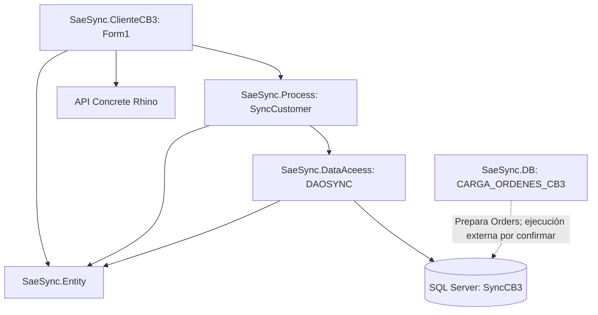

# SaeSync.ClienteCB3: documentación y contexto de implementación

Última revisión estática: 2026-10-23.

## 1. Propósito y uso

Este documento describe lo que está construido en `SaeSync.ClienteCB3`, sus relaciones con la solución y las limitaciones conocidas. Debe leerse antes de modificar la integración con Concrete Rhino y actualizarse al terminar cada cambio funcional.

Documentos complementarios:

- [Contrato y contexto de la API Concrete Rhino](CONTEXTO_API_CONCRETE_RHINO.md): comportamiento esperado del proveedor, endpoints, campos, restricciones y ejemplos.
- Este archivo: implementación local observada, dependencias, flujos, pendientes y evidencia de validación.

El contrato de la API no demuestra que una función esté implementada. Las propuestas de este documento tampoco son funcionalidad existente.

Nombre real del proyecto en disco y en la solución: **`SaeSync.ClienteCB3`**. Las referencias conversacionales a `SaeSync.Clientes.CB3` corresponden a este proyecto.

## 2. Estado general

Existe una aplicación Windows Forms que permite leer clientes y pedidos desde SQL Server y enviarlos manualmente a Concrete Rhino mediante HTTP. La UI y la comunicación HTTP residen en `Form1`; las lecturas pasan por las capas compartidas `SaeSync.Process`, `SaeSync.DataAceess` y `SaeSync.Entity`.

Los flujos son prototipos incompletos: contienen valores de prueba y diferencias respecto del contrato del proveedor. La compilación Debug satisfactoria se reportó en la revisión anterior, con advertencias en proyectos compartidos; no se ha validado una sincronización completa contra una planta. Este documento registra lo observado en el código, no acredita que las capacidades propuestas estén implementadas.

| Funcionalidad | Estado observado |
|---|---|
| Inicio de aplicación y formulario | Implementado |
| Configuración de URLs | Implementada para clientes, pedidos y consulta |
| Lectura SQL de clientes | Implementada mediante procedimiento externo |
| Lectura SQL de pedidos | Implementada mediante procedimiento externo, con valores sustituidos |
| Envío de clientes | POST individual, manual; requiere adecuaciones |
| Envío de pedidos | POST individual, manual; requiere correcciones |
| Consulta de pedidos de Rhino | Campo de URL y botón presentes; botón sin evento conectado y sin solicitud GET |
| API key por solicitud | No observada en los flujos revisados |
| Interpretación de `request_status` | No implementada en los envíos revisados |
| Tickets/remisiones por API | No encontrados en el cliente |
| Materiales y diseños de mezcla por API | No encontrados en el cliente |
| Recolección de resultados/cursor | No encontrada en el cliente |
| Sincronización automática | No encontrada en el cliente |
| Confirmaciones persistentes y reintentos | No encontrados en los flujos CB3 |
| Gestión de errores SQL/HTTP para un coordinador | Parcial; el DAO puede devolver una lista vacía/parcial tras un error y el envío no devuelve un resultado tipado |

## 3. Plataforma y dependencias

| Elemento | Configuración observada |
|---|---|
| Tipo de aplicación | Windows Forms, `WinExe` |
| Framework | .NET Framework 4.6.2 |
| Plataforma Debug/Release | AnyCPU |
| JSON | Newtonsoft.Json 13.0.3 |
| HTTP | System.Net.Http / HttpClient |
| SQL | System.Data.SqlClient, en acceso a datos |
| Configuración | System.Configuration |

Las bibliotecas `SaeSync.Process`, `SaeSync.DataAceess` y `SaeSync.Entity` también apuntan a .NET Framework 4.6.2 en sus proyectos revisados.

Fuentes: [proyecto CB3](../SaeSync.ClienteCB3.csproj), [Process](../../SaeSync.Process/SaeSync.Process.csproj), [DataAceess](../../SaeSync.DataAceess/SaeSync.DataAceess.csproj), [Entity](../../SaeSync.Entity/SaeSync.Entity.csproj).

## 4. Arquitectura y relaciones



### Referencias de proyecto

- CB3 referencia directamente `SaeSync.Process` y `SaeSync.Entity`.
- `Process` referencia `DataAceess` y `Entity`.
- `DataAceess` referencia `Entity`.
- CB3 no referencia directamente `SaeSync.DB` ni `SaeSync.DataAceess`.
- La conexión de `SaeSync.DB` con CB3 es por objetos SQL y datos compartidos, no por una llamada al proyecto de base de datos.

Otros ejecutables de la solución que referencian `Process` y `Entity`: `SaeSync.Cliente`, `SaeSync.ClienteCP`, `SaeSync.Client`, `SaeSync.WinService`, `SaeSync.WSRemisiones` y `SyncAspelSP`. No son dependencias directas de CB3; comparten bibliotecas. Cambiar entidades o comportamiento de las capas compartidas requiere revisar sus consumidores y marcos de destino.

### Distribución actual de responsabilidades

| Proyecto | Responsabilidad en el flujo CB3 |
|---|---|
| `SaeSync.ClienteCB3` | Interfaz, construcción de JSON, envío HTTP, presentación de respuestas y errores |
| `SaeSync.Process` | Métodos que delegan las lecturas de clientes/pedidos a acceso a datos |
| `SaeSync.DataAceess` | Consultas SQL, lectura de columnas y construcción de entidades; archivo de errores CB3 |
| `SaeSync.Entity` | Modelos compartidos de clientes, pedidos y cargas |
| `SaeSync.DB` | Proyecto SQL de la solución. Incluye DDL y `CARGA_ORDENES_CB3`, que prepara pedidos en la base externa `SyncCB3`; CB3 no invoca ese procedimiento desde los botones revisados |

La lógica HTTP está en el formulario. La capa `Process` todavía no coordina un proceso completo de sincronización CB3.

## 5. Archivos y puntos de entrada

| Archivo | Contenido relevante |
|---|---|
| [Program.cs](../Program.cs) | `Main()` inicia Windows Forms y abre `Form1` |
| [Form1.cs](../Form1.cs) | Cliente HTTP, carga de URLs, lectura de datos, envíos y eventos |
| [Form1.Designer.cs](../Form1.Designer.cs) | Controles y conexiones de eventos |
| [ConfigReader.cs](../ConfigReader.cs) | Lectura de las tres URLs desde configuración |
| [App.config](../App.config) | Configuración del ejecutable y cadenas de conexión; no reproducir secretos en documentación |
| [SyncCustomer.cs](../../SaeSync.Process/SyncCustomer.cs) | Entrada de procesos para las lecturas CB3 y otros procesos compartidos |
| [ISyncCustomer.cs](../../SaeSync.Process/ISyncCustomer.cs) | Interfaz compartida; declara lectura de clientes CB3, no lectura de pedidos CB3 |
| [DAOSYNC.cs](../../SaeSync.DataAceess/DAOSYNC.cs) | Consultas a `cnCB3`, mapeo de filas y bitácora de errores |
| [Order.cs](../../SaeSync.Entity/Order.cs) y [customer.cs](../../SaeSync.Entity/customer.cs) | Entidades compartidas usadas para materializar y enviar pedidos/clientes |

## 6. Flujo de inicio y configuración

1. `Program.Main()` habilita estilos de Windows Forms y ejecuta `new Form1()`.
2. `Form1` lee las URLs mediante `ConfigReader`.
3. Construye un HttpClient reutilizable con descompresión GZip/Deflate, timeout de 30 segundos y encabezado `Accept: application/json`.
4. Inicializa los campos de texto con las URLs configuradas.
5. Espera acciones manuales del usuario.

| Clave | Uso observado |
|---|---|
| `UrlPutCustomers` | URL inicial del campo `txtURL` |
| `UrlPutOrders` | URL inicial del campo `txtUrlPedidos` |
| `UrlGetOrders` | URL inicial del campo `txtUrlGetOrders` |
| `cnCB3` | Conexión usada por DAOSYNC para leer clientes y pedidos; base `SyncCB3` |
| `cnPedidos` | Conexión configurada a `Pedidos`; no usada por las dos lecturas CB3 revisadas |
| `archivo` | Clave presente; el archivo de errores CB3 usa un nombre construido directamente |

Los nombres `UrlPut*` no reflejan el método actual: los envíos implementados usan POST. No se observó configuración/envío de una API key en estos flujos.

Las capas compartidas acceden a `ConfigurationManager`, por lo que la configuración efectiva depende del ejecutable que las carga. No asumir que una configuración existente en otro ejecutable está disponible en CB3.

## 7. Flujo de clientes construido

```text
btnAccion_Click
  -> LeerClientes("MTY")
  -> SyncCustomer.GetCustomersSyncCB3("MTY")
  -> DAOSYNC.GetCustomersSyncCB3("MTY")
  -> cnCB3 / sp_Customers_GetAll(@CveCiudad)
  -> List<customer>
  -> por cada registro: await ACCION(cliente)
  -> POST al valor de txtURL
```

Detalles:

- `LeerClientes(string CveCiudad)` ignora su parámetro y pasa el literal `MTY`.
- El DAO configura un timeout SQL de 120 segundos.
- La lectura es síncrona y ocurre desde el evento del formulario antes del envío HTTP asincrónico.
- El cuerpo tiene estructura `customers: [{customer: {...}}]` y se serializa a JSON UTF-8.
- Se envían código, nombre, contacto, teléfono, móvil, dirección, fax y correo.
- `cust_id` no se envía; `cust_udf1` y `cust_udf2` están comentados en el cuerpo.
- Se aplica `LimpiaCaracteres` a varios textos; utiliza una expresión regular basada en caracteres de URI, no una validación del contrato de la API.
- Las solicitudes son secuenciales dentro de cada ejecución del botón.
- La URL usada es `txtURL`, el campo de clientes.
- La validación de URL registra el error, pero no retorna porque el `return` está comentado; el método puede continuar con `uri` nula o inválida y fallar al usarla.
- Aunque se envía POST y se evalúa el estado HTTP, no se agrega API key ni se interpreta `request_status`. El bloque de deserialización intenta leer `Message`; un error de deserialización se captura y no propaga el fallo funcional.

### Mapeo SQL de clientes observado

| Propiedad | Origen en SqlDataReader |
|---|---|
| `cust_id` | Columna 0, Int32 |
| `cust_code` | Columna 1, Int32 |
| `cust_name` | Columna 2, string |
| `cust_first_name` | También columna 2, string |
| `cust_phone` | Columna 4 |
| `cust_mobile` | Columna 5 |
| `cust_fax` | Columna 6 |
| `cust_email` | Columna 7 |
| `cust_address` | Columna 8 |
| `cust_udf1` | Literal `"1"`, no enviado actualmente |
| `cust_udf2` | Literal `"3"`, no enviado actualmente |

La columna 3 no se utiliza. Sin la definición del procedimiento no se puede confirmar si debería contener el contacto. No cambiar ese mapeo suponiendo el significado de la posición.

## 8. Flujo de pedidos construido

```text
btnPedidos_Click
  -> ReadOrders("MTY")
  -> SyncCustomer.ReadOrdersSyncCB3("MTY")
  -> DAOSYNC.ReadOrdersSyncCB3("MTY")
  -> cnCB3 / Sp_Orders_GetToday()
  -> List<Order>
  -> por cada registro: await ACCION_PEDIDOS(elemento)
  -> POST al valor de txtURL
```

Detalles:

- `ReadOrders(string CveCiudad)` ignora su argumento y pasa `MTY`.
- En DAOSYNC, el parámetro SQL de ciudad está comentado; el procedimiento se invoca sin parámetros.
- Timeout SQL: 120 segundos. Consulta síncrona.
- El cuerpo tiene estructura `orders: [{order: {...}}]`.
- `ACCION_PEDIDOS` usa `txtURL`, correspondiente a clientes, en lugar de `txtUrlPedidos`.
- El campo enviado `delivey_addrs` está mal escrito; el proveedor espera `delivery_addrs`.
- El formulario reemplaza `mix_code` por `C070G212D28XX1N4`.
- El envío usa POST individual y secuencial; no se selecciona PUT para actualización ni hay control durable de duplicados.
- `wanted_date` se serializa desde DateTime sin un formato específico para fecha de negocio; debe adecuarse explícitamente a `yyyy-MM-dd` antes de dar por cumplido el contrato.
- La respuesta se trata como éxito si el estado HTTP es exitoso, sin validar el `request_status.status` de Concrete Rhino.

### Mapeo SQL de pedidos observado

| Campo | Origen actual |
|---|---|
| `order_num` | Columna 0, Int32 |
| `status_id` | Columna 1, Int32 |
| `plant_code` | Columna 2 |
| `cust_code` | Columna 3 |
| `delivey_addrs` | Columna 4 |
| `wanted_date` | Columna 5, DateTime |
| `wanted_time` | Columna 6 |
| `mix_code` | Columna 7, después sustituida por el formulario |
| `quantity` | **Literal 5**; lectura de columna 8 comentada |
| `load_size` | **Literal 7**; lectura de columna 9 comentada |
| `num_loads` | Columna 10, Int32 |

Cantidad, tamaño de carga y mezcla enviados no representan necesariamente los valores del pedido almacenado.

## 9. Entidades existentes

| Clase | Uso/observación |
|---|---|
| [customer](../../SaeSync.Entity/customer.cs) | Usada en lectura/envío; código de cliente definido como int |
| [Order](../../SaeSync.Entity/Order.cs) | Usada en lectura/envío; campos públicos, número de pedido y cantidad int, carga float |
| [Customer_CB3](../../SaeSync.Entity/Customer_CB3.cs) | Modelo alternativo con información de cliente; no se encontró uso en los flujos revisados |
| [Orden](../../SaeSync.Entity/Orden.cs) | Modelo de pedido con cargas; no se encontró conectado a una consulta HTTP del cliente |
| [Load](../../SaeSync.Entity/Load.cs) | Modelo de carga con datos de dosificación/operación |
| [LoadWrapper](../../SaeSync.Entity/LoadWrapper.cs) | Envuelve `Load` bajo la propiedad `load` |

Limitaciones de modelado:

- Rhino admite códigos alfanuméricos; `customer.cust_code` int pierde ceros iniciales y no admite letras.
- `Order.order_num` int restringe el identificador de texto admitido por la API.
- `Order.quantity` y las cantidades de `Orden` son enteros y no representan volúmenes fraccionarios.
- `Order` contiene la misma errata `delivey_addrs` utilizada en el JSON.
- Las entidades `customer` y `Order` son compartidas; cambiar sus tipos/nombres puede requerir adaptación de otros consumidores, no solo del formulario CB3.
- La existencia de `Orden`, `Load` y `LoadWrapper` no demuestra que ya exista recuperación de cargas.
- No se encontró un modelo de respuesta común con `request_status`, ni modelos conectados a los envíos de tickets o al cursor de resultados.

Antes de cambiar tipos compartidos, revisar todas sus referencias. Una alternativa propuesta es crear DTO específicos para solicitudes/respuestas de Rhino y mantener conversiones explícitas desde modelos locales.

## 10. Dependencias SQL y relación con SaeSync.DB

Fuentes: [CARGA_ORDENES_CB3.sql](../../SaeSync.DB/dbo/Stored%20Procedures/CARGA_ORDENES_CB3.sql), [DAOSYNC.cs](../../SaeSync.DataAceess/DAOSYNC.cs).

`CARGA_ORDENES_CB3`:

1. Ejecuta DELETE de `SyncCB3.dbo.Orders` sin filtro.
2. Inserta pedidos obtenidos de `PedidoDetalle`, `Plantas`, `PedidoProducto`, `Pedidos` y `Clientes`.
3. Filtra planta `M4` y fecha de compromiso del día actual del servidor SQL.
4. Usa mezcla fija `C150G310D28XX0N`, diferente del literal del formulario.
5. Construye dirección con datos del cliente.
6. Calcula tamaño de carga con cantidad/viajes; si viajes es cero, devuelve cero.

No se encontró una llamada a este procedimiento desde el flujo del cliente revisado. La preparación de `SyncCB3.dbo.Orders` y su programación externa deben confirmarse; no asumir que pulsar ENVIAR refresca esa tabla. `SaeSync.DB` sí está incluido como proyecto en `SaeSync.sln`, pero no aparece como referencia de proyecto de `SaeSync.ClienteCB3`.

No se encontraron las definiciones de `sp_Customers_GetAll` ni `Sp_Orders_GetToday` en los scripts revisados de la solución. Son dependencias externas pendientes de documentar, incluyendo columnas, tipos, nulabilidad, filtros y origen de datos.

Las tablas [Sync_Ejecucion](../../SaeSync.DB/dbo/Tables/Sync_Ejecucion.sql) y [Sync_Detalle](../../SaeSync.DB/dbo/Tables/Sync_Detalle.sql) existen en el modelo de base de datos. No se observó su uso en los envíos CB3. Su posible reutilización es una decisión futura; no proporcionan por sí mismas cursor por planta ni detalle de componentes Rhino.

## 11. Manejo de errores y operación actual

### HTTP

- Se evalúa `response.IsSuccessStatusCode` y se deserializa a `dynamic`.
- Se intenta leer `apiResponse?.Message`, no `request_status`.
- En pedidos se muestra un mensaje de éxito por respuesta HTTP satisfactoria. Incluso el fallo de deserialización dentro de esa rama puede terminar mostrando éxito.
- Se capturan `TaskCanceledException`, `HttpRequestException` y otras excepciones.
- Los métodos de envío retornan `Task`, sin un resultado funcional que permita al ciclo contabilizar éxitos/fallos o decidir reintentos.
- Se registran cuerpos y respuestas en un StringBuilder mostrado en `txtMensajes`; no se encontró persistencia de confirmaciones HTTP.
- Los botones no se deshabilitan durante el proceso; otra pulsación puede iniciar una ejecución superpuesta mientras una solicitud espera.
- Las llamadas de lectura SQL ocurren sincrónicamente desde los eventos WinForms y pueden bloquear la interfaz hasta completar el procedimiento (timeout configurado: 120 segundos).
- El botón `btnSendOrders` con texto `SYNC` no tiene manejador `Click`; `UrlGetOrders` solo inicializa el campo visual.

### SQL

- Lectura por ordinal y getters tipados, sin comprobaciones explícitas de DBNull en estos mapeos.
- Conexiones, comandos y lectores se cierran/liberan en finally.
- Las excepciones dentro de las consultas se registran en archivo y el método devuelve la lista acumulada: puede quedar vacía o parcial sin señalar el fallo al llamador.
- Si falla la escritura del archivo de error, puede propagarse una excepción adicional.
- El registro CB3 escribe `SYNC_CB3_<año><mes><día>.txt` en una ruta relativa, sin ceros de relleno. La inserción de bitácora SQL está comentada en `EscribirBitacora_cb3`.

No confundir “sin datos” con “lectura fallida”, ni HTTP 200 con operación aceptada por Rhino.

## 12. Hallazgos pendientes priorizados

Los identificadores sirven para seguimiento; todos están pendientes en esta revisión.

| ID | Prioridad | Hallazgo | Consecuencia |
|---|---|---|---|
| CB3-01 | Alta | No interpretar `request_status.status` | Rechazos del proveedor pueden informarse como éxito |
| CB3-02 | Alta | No enviar API key | Incompatibilidad con autenticación de la revisión documentada |
| CB3-03 | Alta | Pedidos toman URL de clientes | Envío al recurso incorrecto |
| CB3-04 | Alta | Cantidad 5, carga 7 y mezcla fija | Datos enviados distintos de la operación real |
| CB3-05 | Alta | POST usado como sincronización | Reenvío de existentes produce conflicto; falta estrategia de actualización |
| CB3-06 | Alta | `delivey_addrs` en vez de `delivery_addrs` | Dirección ignorada por el proveedor |
| CB3-07 | Media | IDs y cantidades restringidos a int | Códigos/volúmenes válidos no representables |
| CB3-08 | Media | Ciudad fija y filtro de pedidos no enviado | Alcance por planta/ciudad incompleto |
| CB3-09 | Media | Fallos SQL devuelven lista vacía/parcial | Sincronización incompleta no distinguible de lectura correcta |
| CB3-10 | Media | No persistir resultado por registro | Sin recuperación durable ni conciliación de envíos |
| CB3-11 | Media | Fechas, longitudes y nulos sin validación contractual | Rechazos o truncamientos no controlados |
| CB3-12 | Media | Botones permiten ejecuciones superpuestas | Reenvíos concurrentes desde la misma interfaz |
| CB3-13 | Media | Falta definición de procedimientos externos | No se puede reproducir ni verificar todo el flujo SQL con SaeSync.DB |
| CB3-14 | Media | Preparación de Orders borra todo y usa valores/filtros fijos | No funciona como cola durable general por planta |
| CB3-15 | Baja | `ISyncCustomer` no declara lectura de pedidos | La interfaz no representa todas las operaciones CB3 de la clase |
| CB3-16 | Baja | Consulta de pedidos sin evento | Control visible sin función implementada |

La prioridad refleja impacto técnico observado, no una aprobación para modificar reglas de negocio o desplegar cambios.

## 13. Dirección propuesta para continuar

Esta sección es una propuesta; no describe clases ya implementadas.

1. Crear un cliente HTTP de Rhino independiente del formulario, con autenticación y resultado tipado que separe HTTP status de estado API.
2. Definir DTO de solicitud/respuesta según el contrato y adaptadores desde los registros locales; distinguir campo omitido de valor enviado.
3. Corregir extracción y mapeo, eliminando sustituciones de prueba y documentando procedimientos externos.
4. Añadir coordinación en `Process`: validación, selección de planta, envío, registro de resultado y conciliación de respuestas inciertas.
5. Mantener el formulario como interfaz manual del coordinador para poder reutilizarlo desde un servicio sin duplicar reglas.
6. Diseñar persistencia de confirmaciones, correlación y cursor antes de incorporar reintentos automáticos o recuperación de resultados.

Conservar los comportamientos de otros ejecutables al modificar bibliotecas compartidas. No cambiar globalmente entidades o DAOSYNC para CB3 sin revisar el impacto en clientes, servicios y Carta Porte.

## 14. Validación realizada y límites

La revisión anterior reportó la ejecución del siguiente build el 2026-10-23:

```text
MSBuild.exe SaeSync/SaeSync.ClienteCB3/SaeSync.ClienteCB3.csproj /t:Build /p:Configuration=Debug /nologo /verbosity:quiet
```

Resultado reportado: código de salida 0, sin errores, con ocho advertencias en `SaeSync.DataAceess`: cuatro por uso obsoleto de `ConfigurationSettings.AppSettings` y cuatro por variables `ex` no utilizadas. El análisis documentado aquí es estático; no se volvió a ejecutar el build durante esta actualización.

El build incluyó las dependencias referenciadas. Esto confirma compilación, no compatibilidad operativa con Rhino ni disponibilidad de los procedimientos SQL.

No se ejecutaron llamadas a la API, procedimientos contra bases reales, pruebas de autenticación, envíos de datos, consulta de resultados ni pruebas de interfaz. La actualización de este documento no modifica código funcional.

## 15. Decisiones pendientes de negocio e infraestructura

- Plantas iniciales, URLs, identidad de cada destino y claves de acceso.
- Alcance inicial: clientes/pedidos o también tickets y resultados.
- Origen y mantenimiento de los procedimientos de la base `SyncCB3`.
- Responsable y periodicidad de preparación de la tabla Orders.
- Correspondencia de pedido cabecera/hijo con `order_num`.
- Correspondencia de mezcla/producto, cliente por ciudad, unidad y operador.
- Política para remisiones alfanuméricas frente a tickets numéricos Rhino.
- Propiedad de cambios hechos localmente y en planta.
- Unidades y precisión de cantidades; dirección de entrega correcta.
- Destino de bitácoras, confirmaciones y resultados, y su retención.

Consultar también los pendientes contractuales del [contexto de la API](CONTEXTO_API_CONCRETE_RHINO.md), especialmente `cust_udf2`, límites de texto, versión instalada, impuestos y cursor de resultados.

## 16. Mantenimiento del documento

Al finalizar cada cambio:

1. Actualizar fecha y estado funcional.
2. Describir el comportamiento final y enlazar archivos reales.
3. Actualizar dependencias, configuración, objetos SQL y mapeos afectados, sin copiar credenciales.
4. Marcar los hallazgos resueltos y registrar evidencia; no declarar una propuesta como implementada.
5. Registrar pruebas ejecutadas y límites de validación.
6. Actualizar el contrato de API solo si cambió la fuente del proveedor o se obtuvo una aclaración verificable.

### Historial

| Fecha | Cambio | Verificación |
|---|---|---|
| 2026-10-23 | Documentación inicial del cliente, capas compartidas, flujos SQL/HTTP y pendientes | Revisión de código y compilación Debug satisfactoria; sin pruebas contra planta |
| 2026-10-23 | Contraste adicional de formulario/diseñador, referencias de solución, entidades y DAO; se precisó que `SYNC` no tiene evento y se actualizó el mapa de dependencias | Revisión estática; sin compilación nueva ni pruebas contra planta |
